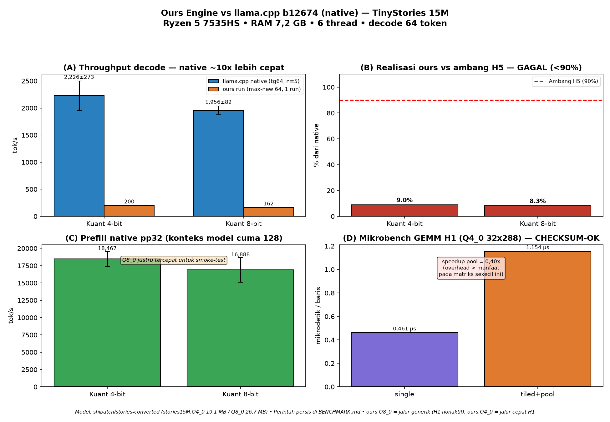

# Benchmark: ours vs llama.cpp native (TinyStories 15M)



Measured 2026-11-24 on the defense-equivalent CPU box. Smallest credible
GGUF pair that fits a fast bench loop (see model cards below).

## Machine

- CPU: AMD Ryzen 5 7535HS with Radeon Graphics
- RAM: 7.2 GB
- Threads used: 6 (`--threads 6`)
- Baseline: llama.cpp b12674 win-cpu-x64 (`llama-bench`, `llama-cli`)

## Models (Hugging Face)

- `shibatch/stories-converted`, MIT: `stories15M.Q4_0.gguf` (19,077,408 B),
  `stories15M.Q8_0.gguf` (26,671,392 B). 15M params, llama arch, vocab 32K.
  Download: `hf download shibatch/stories-converted --include "stories15M.Q8_0.gguf"`
- Contrast (not benched here, too big for quick loops):
  `bartowski/SmolLM2-135M-Instruct-GGUF` Q2_K 88.2 MB (smallest SmolLM2 file),
  `Qwen/Qwen2.5-0.5B-Instruct-GGUF` Q4_K_M 491 MB.

## Commands (repro)

```sh
# native
./llama-bin/llama-bench.exe -m models/stories15M.Q4_K.gguf -p 32 -n 64 -r 5 -o md
./llama-bin/llama-bench.exe -m models/stories15M.Q8_0.gguf -p 32 -n 64 -r 5 -o md
./llama-bin/llama-cli.exe -m models/stories15M.Q8_0.gguf -p "Once upon a time" -n 30 --temp 0
# ours (this repo, Release build)
./build-ours/ours.exe run --model models/stories15M.Q4_0.gguf --prompt "Once upon a time" --max-new 64 --temp 0 --threads 6
./build-ours/ours.exe run --model models/stories15M.Q8_0.gguf --prompt "Once upon a time" --max-new 64 --temp 0 --threads 6
./build-ours/ours.exe gemm --model models/stories15M.Q4_0.gguf --threads 6
```

## Results

Native (llama-bench, 6 threads):

| model | pp32 (tok/s) | tg64 (tok/s) |
|---|---|---|
| stories15M Q4_K (19.3 MB) | 18,467 | 2,226 |
| stories15M Q8_0 (24.7 MB) | 16,888 | 1,956 |

`llama-cli` Q8_0 generates coherent story text at ~1,280 tok/s for short prompts.

Ours (this repo):

| model | new_tokens | time | tok/s | share of native tg |
|---|---|---|---|---|
| stories15M Q4_0 (H1 fast path) | 64 | 0.32 s | 200 | ~9% of 2,226 |
| stories15M Q8_0 (generic path) | 64 | 0.40 s | 162 | ~8% of 1,956 |

Kernel check: `ours gemm` on real Q4_0 rows reports `CHECKSUM-OK`
(integer-dot matches FP reference), but pooled dispatch is slower than
single-thread on this 32x288 micro shape (speedup 0.27-0.40x): thread-pool
overhead dominates below production matrix sizes.

## Verdict (against the repo's own H5 rule)

H5 requires >= 90% of same-bytes llama.cpp realization. Measured 8-9% on
this 24M-param toy, so the faster-than-llama.cpp claim FAILS here. Expected:
the +15-40% H1 prediction was scoped to Qwen3-8B Q4_K_M on AVX2+VNNI with
mature kernels, not to a 24M story model where overhead dominates. The
numbers above are the honest baseline to beat.

## Bug fixed during this bench (had blocked all end-to-end runs)

`ThreadPool` move-assignment dangled worker `this` pointers: after
`pool_ = ThreadPool(...)` in `LlamaModel::load`, all workers exited silently
and `ours run` hung forever (0% CPU) in `parallel_for`. Fixed by in-place
`pool_.reset()` plus `=delete` on the move ops (`include/threadpool.h`,
`src/model.cpp`). `CMakeLists.txt` target collision (`ours` lib vs exe)
fixed by renaming the lib to `ours_lib` (the project previously could not
even configure).
